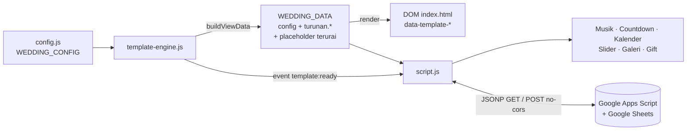

# TECHNICAL DOCS — Arsitektur Kode Sumber

**Proyek:** Undangan Pernikahan Digital *Rustic Floral* · **Mitra:** UD. Rez Wan Jaya
**Pembaca:** pengembang yang akan memelihara atau memperluas template.
Panduan operasional non-teknis ada di [`USER_GUIDE.md`](USER_GUIDE.md).

---

## 1. Ringkasan arsitektur

Aplikasi adalah **situs statis** (HTML + CSS + Vanilla JS, tanpa build step, tanpa framework, tanpa backend sendiri).
Prinsip utamanya: **data dipisah dari tampilan**.

| Lapisan | Berkas | Tanggung jawab |
|---|---|---|
| Data | `assets/js/config.js` | *Single source of truth* data klien |
| Mesin templat | `assets/js/modules/template-engine.js` | Menghitung data turunan, menyelesaikan `{{placeholder}}`, mengisi DOM |
| Interaksi | `assets/js/script.js` | Musik, countdown, kalender, slider peta, galeri, RSVP, scroll |
| Struktur | `index.html` | Kerangka semantik + penanda `data-template-*` |
| Tampilan | `assets/css/variables.css`, `style.css` | *Design tokens* dan gaya komponen |
| Layanan luar | Google Apps Script, Google Maps, Google Calendar, YouTube, Google Fonts | RSVP, peta, kalender, video, font |



### 1.1 Urutan muat & kontrak global

`index.html` memuat tiga skrip biasa (tanpa `defer`) di akhir `<body>`:

```html
<script src="assets/js/config.js"></script>
<script src="assets/js/modules/template-engine.js"></script>
<script src="assets/js/script.js"></script>
```

| Global | Dibuat oleh | Isi |
|---|---|---|
| `window.WEDDING_CONFIG` | `config.js` | Data mentah dari admin |
| `window.TemplateEngine` | `template-engine.js` | API: `getNestedValue`, `isEmpty`, `formatUTCStamp`, `buildViewData`, `render`, `init` |
| `window.WEDDING_DATA` | `TemplateEngine.init()` | Data **final** (turunan + placeholder terurai); dibaca `script.js` lewat `dataAt(path)` |
| event `template:ready` | `TemplateEngine.init()` | Dipancarkan di `document` setelah DOM terisi |

Urutan wajib: **config → engine → script**. Bila `config.js` tidak ada, engine mencatat galat di Console dan berhenti.

---

## 2. Struktur direktori

```
rustic_floral/
├── index.html                  Dokumen HTML5 semantik + Template Tagging
├── README.md                   Ringkasan repo, kendala teknis, Production Readiness Checklist
├── USER_GUIDE.md               Panduan kustomisasi admin
├── TECHNICAL_DOCS.md           Dokumen ini
├── ANNOTATION_INDEX.md         Indeks marker comment (dibuat dari kode)
├── .gitignore
├── docs/
│   └── PRD_Wedding_Invitation_Rustic_Floral.pdf
└── assets/
    ├── css/
    │   ├── variables.css       Design tokens (warna, font, spasi, radius, bayangan, durasi)
    │   └── style.css           Gaya komponen — hanya memakai var(--token)
    ├── js/
    │   ├── config.js           Data klien
    │   ├── script.js           Interaksi (11 seksi, bagian 4)
    │   └── modules/
    │       └── template-engine.js
    ├── images/                 Foto klien (JPG)
    └── music/                  Lagu latar (MP3)
```

Ukuran aset saat ini: 12 gambar JPG (±1,1 MB total), 1 MP3 (±4,1 MB). `index.html` ±820 baris,
`style.css` ±2.830 baris, `script.js` ±1.040 baris.

---

## 3. Template Tagging & Template Engine

### 3.1 Atribut penanda di `index.html`

| Atribut | Efek | Contoh |
|---|---|---|
| `data-template="path"` | Mengisi `textContent` | `<h2 data-template="turunan.nama.pasangan">` |
| `data-template-src="path"` | Mengisi `src` (img, iframe, source) | `` |
| `data-template-href="path"` | Mengisi `href` | `<a data-template-href="acara.akad.mapsUrl">` |
| `data-template-alt` / `-title` / `-content` | Mengisi `alt` / `title` / `content` | `<meta data-template-content="meta.deskripsi">` |
| `data-template-if="path"` | Menyembunyikan elemen (`hidden`) bila nilai kosong | `<section data-template-if="live.aktif">` |

Path memakai notasi titik dan indeks array: `mempelai.pria.namaLengkap`, `cerita.0.judul`, `galeri.foto.3.src`.
Nilai dianggap **kosong** bila `undefined`, `null`, `""`, atau `false`.

> **Keamanan:** teks diisi dengan `textContent`, bukan `innerHTML`, sehingga nilai config tidak dapat menyuntikkan HTML.
> Konsekuensinya `<br>` tidak bekerja; gunakan `\n` pada data dan `white-space: pre-line` pada CSS
> (`.person-family`, `.opening-to`). Nilai `href`/`src` **tidak divalidasi skemanya** — aman selama config ditulis admin.

### 3.2 Alur `TemplateEngine.init()`

1. Ambil `window.WEDDING_CONFIG`.
2. `buildViewData(config)`:
   1. `deepClone` (JSON) agar config asli tidak berubah.
   2. `buatDataTurunan` → menambahkan cabang `turunan.*`.
   3. `resolvePlaceholders` dijalankan **3 putaran** agar referensi berantai (`{{a}}` → teks berisi `{{b}}`) terselesaikan.
3. Simpan hasil ke `window.WEDDING_DATA`.
4. `render(data)`: urutan **`data-template-if` → teks → atribut → `audio.load()`**.
5. Pancarkan `template:ready`.

`init` dipanggil pada `DOMContentLoaded` (atau langsung bila dokumen sudah siap). Karena engine mendaftar lebih dulu
daripada `script.js`, DOM sudah terisi saat `script.js` berjalan.

### 3.3 Data turunan (`turunan.*`)

Dihitung otomatis; **jangan** ditulis di `config.js`.

| Path | Isi | Contoh |
|---|---|---|
| `turunan.nama.pasangan` | `Pria & Wanita` (panggilan) | `Andi & Sari` |
| `turunan.nama.pasanganDan` | `Pria dan Wanita` | `Andi dan Sari` |
| `turunan.nama.pasanganLengkap` | Nama lengkap tanpa gelar | `Andi Prasetyo & Sari Wulandari` |
| `turunan.inisial.pria` / `.wanita` | Huruf pertama panggilan | `A` / `S` |
| `turunan.tanggalUtama.*` | `lengkap`, `lengkapDenganHari`, `lengkapKapital`, `bulanKapital`, `tahun`, … | `21 Februari 2027` |
| `turunan.akad.*`, `turunan.resepsi.*` | `tanggalLengkap`, `waktu`, `mulaiISO`, `selesaiISO`, `kalenderUrl` | `08.00 — 10.00 WIB` |
| `turunan.countdownTarget` | ISO mulai akad (cadangan: 00:00 `tanggalUtama`) | `2027-02-21T08:00:00+07:00` |

`formatTanggal(isoDate)` mengembalikan `null` untuk format salah **dan** tanggal yang tidak ada (mis. `2027-02-31`);
engine lalu mencatat peringatan di Console.

### 3.4 Placeholder `{{path}}`

Regex: `/\{\{\s*([\w.]+)\s*\}\}/g` — hanya huruf/angka/`_`/titik. Path yang tidak ditemukan menghasilkan `""`
dan peringatan `[TemplateEngine] Placeholder tidak ditemukan`. Referensi melingkar tidak dideteksi (berhenti setelah 3 putaran).

---

## 4. `script.js` — modul interaksi

Satu IIFE-style handler pada `DOMContentLoaded`, terbagi menjadi 11 seksi bernomor:

| # | Seksi | Inti |
|---|---|---|
| 1 | Konfigurasi & elemen | Seleksi elemen, `dataAt()`, `GOOGLE_SCRIPT_URL`, volume musik |
| 2 | Pembuka undangan | Tombol *Buka Undangan* → `playMusic()` → sembunyikan sampul (700 ms) → buka kunci scroll |
| 3 | Navbar & scroll-spy | Menandai menu aktif; mengabaikan elemen `hidden` |
| 4 | Countdown | `setInterval` 1 dtk ke `turunan.countdownTarget`; berhenti saat waktu habis |
| 5 | Save to Calendar | Membuat berkas `.ics` (akad) via `Blob` dan mengunduhnya sebagai `<slug>-akad.ics` |
| 6 | Map slider | Slider akad/resepsi, titik penunjuk, mengabaikan slide `hidden` |
| 7 | Galeri | Lightbox modal (desktop) dan slider (mobile, `innerWidth <= 768`) |
| 8 | RSVP & riwayat ucapan | POST ke Apps Script, memuat riwayat via JSONP, paginasi (`PAGE_SIZE = 5`) |
| 9 | Smooth scroll | Tautan `#anchor` menggulir halus ke seksi tujuan |
| 10 | Cek status awal | Bila tidak ada layar pembuka, hapus kelas `locked` dari `<body>` agar halaman bisa di-scroll |
| 11 | Amplop digital | `copyToClipboard()` → `salinRekening()`, `salinAlamatKado()` |

### 4.1 Kopling yang harus dijaga bersama

| Nilai | Lokasi 1 | Lokasi 2 |
|---|---|---|
| Breakpoint mobile `768` | `style.css` `@media (max-width: 768px)` | `script.js` `window.innerWidth <= 768` |
| Animasi sampul `700 ms` | `variables.css` `--duration-700` | `script.js` `setTimeout(..., 700)` |
| Nilai kehadiran `Hadir` / `Tidak Hadir` | `index.html` `<option value>` | `script.js` validasi + Apps Script |
| Slot cerita 4 / foto 6 / rekening 2 | `index.html` (slot tetap) | Panduan admin & `config.js` |

---

## 5. CSS & Design Tokens

- **`variables.css`** adalah satu-satunya tempat nilai visual. Area aman diedit dibatasi penanda
  `DESIGN TOKENS BOUNDARY MARKER … END DESIGN TOKENS BOUNDARY MARKER`.
- Kelompok token: warna (`--color-*`), font (`--font-*`, `--font-size-*`), ketebalan, *letter-spacing*, radius, border,
  bayangan, durasi (`--duration-*`), easing, serta token khusus nama mempelai.
- Font dimuat lewat `@import` Google Fonts di `variables.css` (Cormorant Garamond & Montserrat).
- **`style.css`** seharusnya hanya memakai `var(--token)`. *Catatan:* masih ada literal `px` pada ukuran ornamen dan offset
  (ditandai `REFACTOR(tokens)`).
- `[hidden] { display: none !important; }` bersifat global agar atribut `hidden` dari engine mengalahkan `display: flex/grid`.
- Breakpoint tunggal: **> 768px** desktop, **≤ 768px** mobile, **≤ 480px** kecil (tidak dapat memakai `var()`).
- Format berkas: `variables.css` memakai akhir baris **CRLF**, berkas lain **LF**. Jaga konsistensi agar diff Git tidak berisik.

---

## 6. Skema URL & API eksternal

### 6.1 Google Calendar (tombol *Save The Date*)

Dibuat oleh `turunanAcara()` pada `template-engine.js`:

```
https://calendar.google.com/calendar/render
  ?action=TEMPLATE
  &text=<encodeURIComponent(judul + " " + pasangan)>
  &dates=<mulaiUTC>/<selesaiUTC>
  &details=<encodeURIComponent(judul + " " + pasanganLengkap)>
  &location=<encodeURIComponent(tempat)>
```

- Format tanggal: `YYYYMMDDTHHMMSSZ` (**UTC**). Dibuat oleh `formatUTCStamp()` dari `tanggal + jam + offsetUTC`
  (`2027-02-21T08:00:00+07:00` → `20270221T010000Z`).
- Karakter `/` pada `dates` **sengaja tidak di-encode**.
- Bila tanggal tidak valid, `kalenderUrl` bernilai `""` dan tombol disembunyikan.

### 6.2 Berkas iCalendar (`.ics`)

`script.js` seksi 5 membuat `VEVENT` untuk **akad** memakai `formatUTCStamp()` dan `escapeICS()`
(RFC 5545 §3.3.11). Batasan yang diketahui: tanpa *line folding* 75 oktet, resepsi belum diekspor.

### 6.3 Google Maps

| Kebutuhan | Pola | Sumber |
|---|---|---|
| Tautan buka peta | `https://maps.google.com/?q=<nama+tempat+alamat>` | `acara.*.mapsUrl` |
| Peta tertanam | `https://www.google.com/maps/embed?pb=<parameter>` | `acara.*.mapsEmbedUrl` (Bagikan → Sematkan peta) |

Parameter `pb=` dihasilkan Google dan tidak boleh dibuat tangan.

### 6.4 YouTube

Semua tautan video memakai pola **embed**: `https://www.youtube.com/embed/<VIDEO_ID>`
(`live.embedUrl`, `galeri.videoEmbedUrl`). Tautan `watch?v=` tidak dapat dipakai pada `<iframe>`.

### 6.5 Google Apps Script (RSVP & buku tamu)

Endpoint: `rsvp.googleScriptUrl` (web app, akses publik).

| Operasi | Metode | Detail |
|---|---|---|
| Kirim ucapan | `POST` `mode: "no-cors"`, `Content-Type: text/plain;charset=utf-8` | Body JSON: `{ "name": string ≤100, "attendance": "Hadir" \| "Tidak Hadir", "message": string ≤2000 }` |
| Muat riwayat | `GET` **JSONP**: `<url>?callback=<fn>&_=<timestamp>` | Respons `fn([ {...}, … ])`; `script.js` membaca `name\|nama`, `attendance\|kehadiran`, `message\|ucapan`, `timestamp\|waktu\|date\|tanggal` |

Konsekuensi desain:

- `no-cors` membuat respons POST **tidak terbaca** → UI tidak bisa memastikan penyimpanan berhasil (`FIXME(rsvp)`).
  Setelah 2,5 detik riwayat dimuat ulang sebagai penanda tidak langsung.
- JSONP menjalankan skrip dari endpoint → hanya aman bila Apps Script milik sendiri (`SECURITY(jsonp)`).
  Alternatif jangka panjang: `fetch()` dengan header CORS dari Apps Script.
- Callback global sekali pakai (`guestbookCallback_<ts>_<rand>`) dihapus setelah selesai atau *timeout* 15 dtk.
- Validasi sisi klien (panjang, nilai kehadiran) **bukan** pengaman; Apps Script wajib memvalidasi ulang.

---

## 7. Konvensi Marker Comments

Kode memakai marker `TAG(lingkup): keterangan` — `BUG`, `FIXME`, `SECURITY`, `TODO`, `REFACTOR`, `PERF`, `CLEANUP`, `NOTE` —
ditambah JSDoc (`@param`, `@returns`, `@typedef`). Daftar lengkap beserta nomor baris ada di
[`ANNOTATION_INDEX.md`](ANNOTATION_INDEX.md). Sebelum rilis, **tidak boleh tersisa** `BUG`/`FIXME`/`TODO` yang belum
diputuskan (kerjakan, atau pindahkan ke *issue tracker*).

---

## 8. Panduan pemeliharaan

### 8.1 Menambah data baru pada tampilan

1. Tambahkan properti di `config.js`.
2. Tambahkan elemen di `index.html` dengan `data-template="path"` (dan `data-template-if` bila opsional).
3. Bila nilainya perlu dihitung, tambahkan di `buatDataTurunan()`.
4. Muat ulang; periksa Console untuk `Placeholder tidak ditemukan`.

### 8.2 Menambah slot cerita / foto / rekening

Template memakai **slot tetap**. Salin satu blok `.story-item` / `.gallery-item` / `.gift-account-block`, naikkan indeks
path (`cerita.4.*`), lalu tambahkan datanya di `config.js`. Jika kebutuhan menjadi dinamis, lakukan refactor ke
`<template>` + perulangan (`REFACTOR(loop)`).

### 8.3 Menambah seksi baru

Buat `<section id="...">` dengan penanda *boundary*, tambahkan tautan di navbar (`data-label`), gaya memakai token,
dan seksi bernomor di `script.js` bila perlu interaksi.

### 8.4 Mengubah tema

Hanya sentuh `variables.css` di dalam area *boundary marker*. Jangan menambahkan nilai literal ke `style.css`.

### 8.5 Menambah klien baru

Salin repo → ganti `config.js`, `assets/images/`, `assets/music/` → buat Apps Script + Sheet baru → perbarui
`rsvp.googleScriptUrl` → jalankan checklist di `README.md`. Tidak ada langkah build.

---

## 9. Keterbatasan & utang teknis yang diketahui

| Area | Keterangan | Rujukan |
|---|---|---|
| Pratinjau tautan | Crawler WhatsApp/Facebook tidak menjalankan JS; `<title>`/`<meta>` statis | README kendala #5, `TODO(seo)` |
| RSVP | Status berhasil tidak dapat diverifikasi (`no-cors`) | `FIXME(rsvp)` |
| JSONP | Eksekusi skrip eksternal | `SECURITY(jsonp)` |
| Kalender | `.ics` hanya akad; tanpa *line folding* | `TODO(kalender)`, `FIXME(ics)` |
| Aset | Foto JPG, MP3 ±4 MB dengan `preload="auto"`; belum `loading="lazy"` | `PERF(audio)`, `PERF(img)` |
| Font | `@import` memblokir render | `PERF(fonts)` |
| Skala | Slot konten tetap; tidak ada tautan personal per tamu | bagian 8.2 |
| Notifikasi | Menggunakan `alert()` | `TODO(ux)` |

---

## 10. Pengujian manual (ringkas)

Tidak ada *test runner*; pengujian dilakukan manual lewat UAT (lihat `README.md`). Minimal untuk setiap perubahan:

1. Muat halaman, Console **tanpa galat/peringatan merah**.
2. Ubah satu nilai di `config.js` → tampil benar pada semua tempat yang memakainya.
3. Kosongkan nilai opsional → elemen terkait tersembunyi.
4. Uji **mobile (≤ 768px)** dan **desktop**.
5. Kirim satu RSVP uji dan pastikan baris muncul di Spreadsheet.
